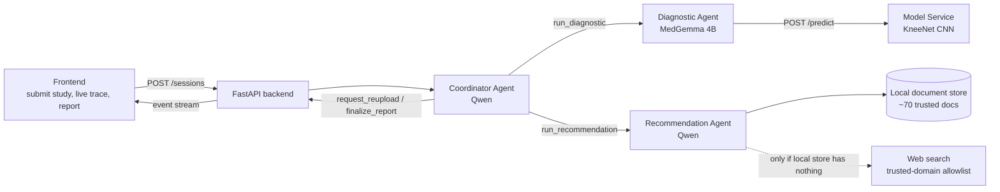

# Knee MRI Abnormality Detection — LLM Multi-Agent System

**COS30018 Intelligent Systems · Project Option A (LLM-Powered Agentic AI Systems) · Swinburne University**

A multi-agent system that looks at a knee MRI study from the
[RSNA Knee Abnormality Detection](https://www.kaggle.com/competitions/rsna-knee-abnormality-detection)
dataset, scores it for 12 abnormalities with a trained CNN, and produces a plain-language report with
evidence-backed recommendations.

---

## Contents

1. [How the system works](#1-how-the-system-works)
2. [Team and ownership](#2-team-and-ownership)
3. [Common language (read this first)](#3-common-language-read-this-first)
4. [Contracts between components](#4-contracts-between-components)
5. [Coding conventions](#5-coding-conventions)
6. [Repository layout and status](#6-repository-layout-and-status)
7. [Installation](#7-installation)
8. [Running the system](#8-running-the-system)
9. [Training the detection model (Kaggle)](#9-training-the-detection-model-kaggle)
10. [Configuration and secrets](#10-configuration-and-secrets)
11. [Testing](#11-testing)
12. [Logging and traces](#12-logging-and-traces)
13. [Open items in the shared contract](#13-open-items-in-the-shared-contract)

---

## 1. How the system works

The trained detection model is a **tool**, not an agent. The agents are LLM-driven loops that decide
when to call tools, read the results, and decide what to do next.



| Agent | LLM | Job | Main tools |
|---|---|---|---|
| **Diagnostic Agent** ("junior doctor") | MedGemma 4B | Check image quality, call the model, compare planes, decide finalize / retry / escalate, write an initial impression | Model Service `/predict`, QC checks |
| **Recommendation Agent** ("senior doctor") | Qwen | Ground the findings in trusted sources, write recommendations with citations and an urgency level, raise concerns about the Diagnostic findings | Local document store first, then web search with allowlist |
| **Coordinator Agent** | Qwen | Own the session state, delegate to the other two agents, resolve disagreements (Recommendation Agent's view weighs more), handle failures, assemble the `FinalReport` | `run_diagnostic`, `run_recommendation`, `request_reupload`, `finalize_report` |
| **Baseline** (for evaluation) | MedGemma 4B | One LLM call with the same input, no tools, no loop, same `FinalReport` shape | none |

The Coordinator runs Qwen because it needs reliable native tool calling: in the 20-scenario validation
Qwen (tools) beat MedGemma (JSON actions) on correct decisions (85.0% vs 76.7%) and needed fewer guardrail
overrides (2.7% vs 8.6%). It shares a model family with the Recommendation Agent, so the junior/senior rule
is enforced by deterministic guardrails rather than left to the Coordinator's judgement.

---

## 2. Team and ownership

| Member | Owns |
|---|---|
| **Ren** | Coordinator Agent, FastAPI backend, baseline, shared config/logging/secrets · detection model architecture and training |
| **Justin** | Evaluation Agent, Agent training and evaluation, data visualisation, Evaluation model testing  |
| **Christina** | Role placeholder |
| **Harsh** | Role placeholder |
| **Xavier** | Role placeholder |

> Update this table.

---

## 3. Common language (read this first)

Use these words, spellings and values **exactly**, in code, in prompts, in the UI and in the report.
If a term is missing, add it here in the same PR that introduces it.

### 3.1 Imaging terms

| Term | Meaning in this project |
|---|---|
| **study** | One knee MRI exam. Identified by `study_id`, which is always the DICOM `StudyInstanceUID` string. |
| **series** | One stack of slices inside a study, identified by `SeriesInstanceUID`. A study usually has several series per plane. |
| **plane** | Viewing direction. One of `"sagittal"` (side-on), `"coronal"` (front-on), `"axial"` (top-down). **Always lowercase**, always in this order. Import `PLANES` from `shared.schema`. |
| **slice** | One 2D image inside a series. The model input uses `N_SLICES = 20` slices per plane at `224 × 224` pixels. |
| **fluid-sensitive series** | The preferred series type for a plane, because fluid (and so most injuries) shows up bright. |
| **fallback level** | How a plane's series was chosen. `1` = fluid-sensitive series found (ideal), `2` = fell back to any series, `3` = plane missing. A study's level is its worst plane. |
| **laterality** | Which knee: `"left"`, `"right"` or `"unknown"`. Matters because medial/lateral swap sides between knees. |
| **laterality_source** | Where laterality came from: `"dicom_tag"` (reliable), `"inferred"` (less reliable), `"unavailable"`. |

### 3.2 Findings

There are exactly **12 findings**. The names are the `train.csv` column names, case- and
punctuation-sensitive. Never retype them; import `FINDINGS` from `shared.schema`.

```
ACL · MCL · Medial Meniscus · Lateral Meniscus · Medial OA · Lateral OA ·
PF OA · Effusion · Synovitis · Baker's · Contusion · Fracture
```

Watch out for: `Baker's` (with apostrophe), `PF OA` (with a space), `Medial Meniscus` (two words,
capitalised). A wrong name fails validation everywhere in the schema.

### 3.3 Numbers: probability vs confidence

These are different things and must not be swapped.

| Term | Range | Produced by | Meaning |
|---|---|---|---|
| **probability** (`findings[...]`, `scores[...]`) | 0–1 | Model Service | How likely the finding is present. |
| **per-plane probability** (`per_plane`) | 0–1 | Model Service | The same, computed from one plane only. |
| **per_finding_confidence** | 0–1 | Diagnostic Agent | How much the agent trusts that probability (e.g. planes agree, quality is fine). |
| **overall_confidence** | 0–1 | Diagnostic Agent | Trust in the study's result as a whole. |
| **cross_plane_variance** | 0–1 | Diagnostic Agent | Only for findings where planes disagree noticeably. |

Thresholds (from config, never hard-coded):

| Setting | Default | Used for |
|---|---|---|
| `REPORT_THRESHOLD` | `0.5` | A finding at or above this appears in the final report. |
| `LOW_CONFIDENCE_THRESHOLD` | `0.6` | Below this, a reported finding is marked `low_confidence: true` and may trigger a recheck. |

### 3.4 Quality flags

Short machine-readable strings in `quality_flags`. Current vocabulary:

| Flag | Meaning |
|---|---|
| `low_slice_count` | A plane had fewer than 15 original slices, so some of the 20 model slices are repeats. |
| `missing_plane:<plane>` | That plane is not in the study, e.g. `missing_plane:axial`. |

Add new flags here before using them. Format: `lower_snake_case`, with `:<detail>` for a parameter.

### 3.5 Labels (training only)

| Term | Meaning |
|---|---|
| **gold label** | One of the 58 studies with all 12 findings filled in `train.csv`. Weight `1.0`. |
| **weak label** | A study whose labels come from keyword rules over its written report. Weight `0.5` (`--weak-weight`). 250 weak studies are in `manifest.csv`. |
| **weak label file** | The weak labeller's CSV: `study_id` + the 12 `FINDINGS` columns. Cells are `1` present, `0` absent/normal, `-1` hedged ("possible"), blank not mentioned; `-1` and blank both become unknown. Any other value is rejected. |
| **label_source** | Column value `"gold"` or `"weak"`. |
| **manifest** | `model_service/knee_model/manifest.csv`: the working subset (`study_id, label_source, fallback_level`). |
| **unknown label** | `NaN` in a label cell. Masked out of the loss, never treated as 0. |
| **splits.csv** | Which studies are `train` or `val` in a run. v1 reuses v0's file (`--split-csv`) so both are scored on the same gold validation studies. |

### 3.6 Agent and session vocabulary

| Term | Allowed values | Meaning |
|---|---|---|
| **agent name** (`AgentName`) | `coordinator`, `diagnostic`, `recommendation`, `model_service`, `baseline` | Used in logs, events and `get_settings().model_for(...)`. |
| **task_type** | `"initial"` or `"recheck: <specific ask>"` | Set by the Coordinator. A recheck says what to look at, e.g. `"recheck: Fracture without Effusion is unusual"`. |
| **focus_findings** | list of finding names | The findings a recheck should concentrate on. |
| **decision** (`DiagnosticDecision`) | `finalize`, `retry`, `escalate` | How the Diagnostic Agent's loop ended. |
| **impression** | short free text | The Diagnostic Agent's initial guess in plain words, e.g. "Likely ACL tear with effusion; meniscus uncertain". Passed through to the Recommendation Agent unchanged. |
| **concerns** | list of free text | The Recommendation Agent's clinical doubts about the Diagnostic findings. |
| **suggested_recheck** | list of finding names | Findings the Recommendation Agent wants re-examined. The Coordinator decides whether it happens. |
| **recheck round** | 0 to `MAX_RECHECK_ROUNDS` (default 2) | One Coordinator → Diagnostic recheck triggered by a disagreement. |
| **urgency** (`UrgencyLevel`) | `routine`, `see_doctor_soon`, `urgent` | Set by the Recommendation Agent. |
| **evidence_status** (`EvidenceStatus`) | `grounded_local`, `grounded_web`, `no_credible_source_found` | Where the recommendation's evidence came from. `no_credible_source_found` must be shown as a gap, never filled with invented text. |
| **session status** (`SessionStatus`) | `pending`, `running`, `completed`, `partial`, `inconclusive`, `failed` | See below. |
| **event kind** (`AgentEvent.kind`) | `decision`, `tool_call`, `tool_result`, `message`, `error`, `status` | One line of the live trace in the UI. |
| **model mode** (`MODEL_MODE`) | `stub`, `replay`, `live` | How the Model Service produces scores (see section 8). |
| **coordinator driver** | `tools`, `json`, `fixed` | How the Coordinator decides: Qwen tool calls, JSON actions (models without tool calling), or no LLM (fixed-workflow baseline). |
| **guardrail** | hard / soft | Code rule that checks every Coordinator tool call. Hard refusals never run; soft refusals run if the LLM asks twice. |

Session status meanings:

| Status | When |
|---|---|
| `completed` | Full report produced, both agents succeeded. |
| `partial` | A report was produced, but an agent failed or evidence is missing (e.g. `no_credible_source_found`). |
| `inconclusive` | Images were not good enough; the user is asked to re-upload (`user_action` says what to do). |
| `failed` | Nothing useful could be produced. `errors` explains why. |

### 3.7 The "junior / senior doctor" rule

When the Diagnostic Agent (junior) and the Recommendation Agent (senior) disagree, the Coordinator
treats the Recommendation Agent's concerns as the more senior opinion: it sends a targeted
`recheck` to the Diagnostic Agent (up to `MAX_RECHECK_ROUNDS`). If the disagreement is still there
after the last round, it goes into `FinalReport.disagreements` rather than being silently resolved.

---

## 4. Contracts between components

All contracts live in **`shared/schema.py`** and are Pydantic v2 models. That file is the single source
of truth: if you need a new field, change it there (in its own PR) and update this table.

| From → To | Request | Response |
|---|---|---|
| Diagnostic Agent → Model Service | `PredictionRequest` | `PredictionResponse` (study-level `findings` + `per_plane` scores, laterality, `quality_flags`, `model_version`, `latency_ms`) |
| Coordinator → Diagnostic Agent | `DiagnosticAgentRequest` | `DiagnosticAgentResponse` |
| Coordinator → Recommendation Agent | `CoordinatorRequest` | `RecommendationResponse` |
| Coordinator / Baseline → UI | — | `FinalReport` (containing `ReportedFinding`s) |
| Every agent → UI trace | — | `AgentEvent` |
| UI → Backend | `PatientMetadata` (age, sex, symptoms, injury mechanism) | — |
| Coordinator (internal) | — | `SessionState`: the one shared state per run (diagnostic and recommendation results per round, recheck count, errors, trace events, final report). Add events with `add_event` / `add_error` / `set_status`, never by appending to `events` directly |
| Kaggle export → Model Service | `ReplayPredictionsFile` (`predictions.json`) | — |

The Coordinator calls the other agents through two plain functions (`agents/coordinator/runners.py`).
Each agent must provide one, and raise any exception on failure:

```python
def diagnostic(request: DiagnosticAgentRequest, *, session_id: str) -> DiagnosticAgentResponse: ...
def recommendation(request: CoordinatorRequest, *, session_id: str) -> RecommendationResponse: ...
```

Rules every contract follows:

- Finding dictionaries always use the exact `FINDINGS` keys. Full dictionaries must contain all 12.
- Probabilities and confidences are floats in `[0, 1]`. The validators reject anything else.
- Agents exchange these objects, never free-form strings. LLM output that must become one of these
  objects goes through `LLMClient.decide(...)`, which validates it and retries on bad JSON.
- `model_version` starting with `stub-` means the scores are random. Never report stub results as
  model performance.

---

## 5. Coding conventions

- **Python 3.10+**, type hints on public functions, `from __future__ import annotations` at the top.
- `snake_case` for functions, variables, files and JSON fields; `PascalCase` for classes;
  `UPPER_CASE` for constants. Enum **values** are lowercase strings.
- Import shared things, never copy them:
  ```python
  from shared.schema import FINDINGS, PLANES, FinalReport      # names and contracts
  from shared.config import get_settings                       # all settings
  from shared.llm import LLMClient, tool_schema, tool_message  # all LLM calls
  from shared.logging_setup import setup_logging, TraceWriter  # logs and traces
  ```
- **No hard-coded models, URLs, thresholds or keys.** Read them from `get_settings()`.
- **All LLM calls go through `LLMClient`** with the agent's name (`client.chat("coordinator", ...)`),
  so tokens and latency are counted per agent for the report. See section 5.1.
- Run modules from the repo root with `python -m package.module`, so `shared` imports resolve.
- Never flip images left–right in augmentation: it swaps medial and lateral findings.
- Recommendation text says **"may indicate"**, never states a diagnosis.
- Lint with `ruff check .` before pushing.

### 5.1 Using the LLM client

Create one `LLMClient` per process and share it. Pass `session_id` so calls show up in the session's trace.

**Qwen agents (Coordinator, Recommendation): native tool calls.** Describe each tool's arguments as a Pydantic
model; the client turns it into a flat schema small models follow well.

```python
from shared.llm import LLMClient, ToolArgumentsError, tool_message, tool_schema

TOOLS = [tool_schema("run_diagnostic", "Score one MRI study and get the Diagnostic Agent's findings.", RunDiagnosticArgs)]

result = client.chat("coordinator", history, tools=TOOLS, session_id=sid)
history.append(result.assistant_message())          # the model must see its own tool calls
for call in result.tool_calls:
    try:
        args = call.parse(RunDiagnosticArgs)         # validates the arguments
    except ToolArgumentsError as error:
        history.append(tool_message(call, str(error)))   # tells the model what to fix
        continue
    history.append(tool_message(call, run_diagnostic(args)))   # Pydantic models, dicts or text
```

**MedGemma (Diagnostic, baseline): JSON-schema output.** MedGemma has no tool calling; use `decide`,
which constrains the output to the schema, validates it and retries once with the error.

```python
decision, calls = client.decide("diagnostic", messages, NextAction, session_id=sid)
```

It raises `LLMOutputError` (with `.last_output`) if the JSON never validates and `LLMError` if Ollama
fails (model not pulled, server down, timeout); the message says which. Handle both as a failed agent step.

**Counting.** Every `LLMResult` has `tokens_in`, `tokens_out`, `latency_ms` and `load_ms` (cold-start time).
`client.on_call` receives every result (use it to add an `AgentEvent`), each call is logged to
`logs/app.jsonl`, and `client.usage_summary()` gives per-agent and total figures for the report.

**Thinking.** Qwen3's thinking mode is off by default (`COORDINATOR_THINK` / `RECOMMENDATION_THINK`). When on,
the reasoning arrives in `result.thinking`, separate from `result.content`.

---

## 6. Repository layout and status

Status key: ✅ working · 🟡 stub or partial · ⬜ planned

```
.
├── agents/
│   ├── coordinator/             ✅ Coordinator Agent (Ren), see agents/coordinator/README.md
│   ├── diagnostic_agent/        ⬜ Diagnostic Agent (Justin)
│   └── recommendation_agent/    ✅ LangGraph RAG loop + Coordinator adapter (Christina), see agents/recommendation_agent/README.md
├── backend/                     ⬜ FastAPI backend: sessions, event stream, baseline (Ren) — planned location
├── evaluation/
│   ├── run_eval.py              ⬜ evaluation runner (30+ cases, multi-agent vs baseline)
│   ├── coordinator_scenarios.py ✅ 20 Coordinator validation scenarios
│   ├── coordinator_validation.py ✅ Coordinator validation runner and metrics
│   └── test_cases/              ⬜ evaluation test set
├── frontend/src/                ⬜ React frontend
├── index.html, script.js, style.css   🟡 static UI prototype
├── model_service/
│   ├── api/main.py              ✅ Model Service API (stub, replay and live modes)
│   ├── knee_model/
│   │   ├── dicom_io.py          ✅ DICOM series → ordered 3D volume
│   │   ├── series_selection.py  ✅ picks one series per plane (fallback levels 1–3)
│   │   ├── preprocess.py        ✅ normalise, sample 20 slices, pad, resize to 224
│   │   ├── pipeline.py          ✅ load_study(): study_id → (3, 20, 224, 224) array + quality flags
│   │   ├── make_manifest.py     ✅ builds manifest.csv (58 gold + 250 weak)
│   │   ├── manifest.csv         ✅
│   │   ├── series_selection.csv ✅
│   │   ├── dataset.py           ✅ float16 .npz cache + training Dataset
│   │   ├── labels.py            ✅ gold + weak label merge, weak file validation, template/check CLI
│   │   ├── model.py             ✅ KneeNet (see section 9)
│   │   ├── train.py             ✅ training loop, split (reusable across runs), checkpoint
│   │   ├── inference.py         ✅ checkpoint → PredictionResponse (shared by live mode and the exporter)
│   │   ├── export_predictions.py ✅ Kaggle: writes predictions.json for replay mode
│   │   └── evaluate.py          ⬜ per-finding AUC and calibration
│   ├── checkpoints/             (git-ignored *.pt; predictions.json goes here for replay mode)
│   ├── notebooks/               Kaggle notebooks
│   └── tests/                   ✅ model-service tests
├── shared/
│   ├── schema.py                ✅ all contracts and shared vocabulary
│   ├── config.py                ✅ typed, validated settings from .env (pinned tags, secrets redacted)
│   ├── llm.py                   ✅ Ollama client (Qwen tool calls, MedGemma JSON, usage logging, health check)
│   ├── logging_setup.py         ✅ JSON logs + per-session trace files
│   └── tests/                   ✅
├── .env.example                 ✅ copy to .env
├── requirements.txt             ✅
└── README.md
```

---

## 7. Installation

### 7.1 Prerequisites

- Python 3.10 or newer
- Git
- [Ollama](https://ollama.com) for the local LLMs
- Enough RAM/VRAM for the chosen models (record the machine you use; the report needs it)

### 7.2 Set up the project

```bash
git clone <repo-url>
cd COS30018_Intelligent-Systems_OptionA

python -m venv .venv
# macOS / Linux
source .venv/bin/activate
# Windows (PowerShell)
.venv\Scripts\Activate.ps1

pip install -r requirements.txt
cp .env.example .env        # Windows: copy .env.example .env
```

### 7.3 Pull the models

The exact tags live in `.env` (`DIAGNOSTIC_MODEL`, `COORDINATOR_MODEL`, `RECOMMENDATION_MODEL`, `BASELINE_MODEL`).
Pull whatever those say, for example:

```bash
ollama pull qwen3:8b
ollama pull medgemma:4b     # use the team-agreed MedGemma 4B tag; update .env if it differs
python -m shared.llm        # checks every model is pulled, Qwen can call tools, MedGemma returns JSON
```

`python -m shared.llm` prints each model's digest (record these in the report), the cold-start load time,
one Qwen tool call and one MedGemma JSON answer, and exits non-zero if anything is missing.
Model names must include a tag (`qwen3:8b`, not `qwen3` or `qwen3:latest`); settings refuse to load otherwise.

---

## 8. Running the system

### 8.1 Model Service

```bash
uvicorn model_service.api.main:app --port 8001 --reload
```

Interactive docs: <http://localhost:8001/docs>. Health check: `GET /health`.

`MODEL_MODE` controls where scores come from:

| Mode | What it does | Use for |
|---|---|---|
| `stub` | Random scores, seeded by `study_id` so the same study always gets the same numbers; about 1 in 5 studies gets `low_slice_count` | Building and testing agents before the model exists |
| `replay` | Reads `predictions.json` exported from Kaggle | Running the full system without a GPU or the dataset |
| `live` | Runs the checkpoint on local DICOMs in `data/` | Final demo, if hardware allows |

All three modes return the same `PredictionResponse`. `GET /health` reports the mode and model version
(HTTP 503 with the reason if a replay file or checkpoint is missing), and `GET /studies` lists the study IDs
replay or live mode can score. A study that is not available returns **404**; agents should treat that as a
failed tool call, not retry it.

**Replay mode setup (no GPU needed).** On Kaggle, after training:

```bash
python -m model_service.knee_model.export_predictions \
    --checkpoint /kaggle/working/run_v1/knee_v1.pt \
    --cache-dir /kaggle/working/cache \
    --dataset-root /kaggle/input/rsna-knee-abnormality-detection \
    --series-csv /kaggle/input/rsna-knee-abnormality-detection/train_series.csv \
    --out /kaggle/working/predictions.json
```

It scores the validation studies in the run's `splits.csv` by default (`--split val`), so the agent
evaluation only ever sees studies the model was not trained on. Download `predictions.json` to
`model_service/checkpoints/predictions.json`, set `MODEL_MODE=replay` in `.env`, restart the service.

`predictions.json` format (`ReplayPredictionsFile` in `shared/schema.py`):

```json
{
  "format_version": 1,
  "model_version": "knee_v1",
  "created_at": "2026-10-28T09:15:00+00:00",
  "source": "kaggle: knee_v1.pt on splits.csv val (72 studies)",
  "predictions": [ { "...one PredictionResponse per study..." } ]
}
```

The file is refused if a study appears twice, if entries come from different checkpoints, or if the
`model_version` is a `stub-*` one. `latency_ms` in replay answers is the service's own lookup time;
model inference time for the report comes from live mode or the Kaggle run.

**Live mode setup.** Put the checkpoint at `MODEL_CHECKPOINT`, the DICOMs under
`LIVE_DATASET_ROOT/LIVE_SPLIT_FOLDER/<study>/<series>/*.dcm` and `train_series.csv` at `LIVE_SERIES_CSV`.
Live mode reads the input size from the checkpoint, so it always matches training.

### 8.2 Coordinator Agent

Smoke run against the running Model Service. The Recommendation Agent is the real one (needs Ollama and the
local index); the Diagnostic Agent is still the interim Model Service adapter:

```bash
python -m agents.coordinator --study-id <study_id>                 # Qwen
python -m agents.coordinator --study-id <study_id> --driver fixed  # no LLM
```

Validation on the 20 scripted scenarios (results in `evaluation/results/coordinator/`):

```bash
python -m evaluation.coordinator_validation --driver fixed         # no Ollama needed
python -m evaluation.coordinator_validation                        # Qwen
python -m evaluation.coordinator_validation --compare --repeats 3  # Qwen vs MedGemma vs fixed
```

It reports valid-call rate, correct-decision rate, override rate and latency.

### 8.3 Backend ⬜

Planned: `uvicorn backend.main:app --port 8000` with these endpoints:

| Endpoint | Purpose |
|---|---|
| `POST /sessions` | Start a run for a `study_id` (+ optional `PatientMetadata`) |
| `GET /sessions/{id}` | Session status and `FinalReport` |
| event stream | Live `AgentEvent`s for the UI trace |
| `POST /baseline` | Same input through the single-call baseline |
| `GET /health` | Model Service, Ollama and model availability |

### 8.4 Frontend

Currently a static prototype: open `index.html` in a browser. The React app in `frontend/` will replace it.

---

## 9. Training the detection model (Kaggle)

The model is **KneeNet**: a greyscale ResNet18 (ImageNet weights, `conv1` averaged to one channel) runs
on every slice; slices are pooled per plane (max pooling by default); each plane has its own head; the
study score is the average over the planes that are present (missing planes are masked).

- Input: `(batch, 3 planes, 20 slices, 224, 224)`
- Output: study logits `(batch, 12)` and per-plane logits `(batch, 3, 12)`
- Loss: masked binary cross-entropy with capped `pos_weight` for rare findings, plus an auxiliary
  per-plane loss (weight `0.3`); gold and weak labels weighted `1.0` / `0.5`
- Optimiser: AdamW with cosine decay, gradient clipping (norm `1.0`), mixed precision on GPU
  (`--no-amp` to turn it off); the backbone is frozen for the first 3 epochs

Steps (run on a Kaggle notebook with the RSNA dataset attached):

```bash
# 1. Cache the preprocessed studies once (float16 .npz per study)
python -m model_service.knee_model.dataset \
    --dataset-root <kaggle-input-dir> \
    --series-csv <path>/train_series.csv \
    --cache-dir <cache-dir>

# 2. v0: gold labels only
python -m model_service.knee_model.train \
    --train-csv <path>/train.csv \
    --cache-dir <cache-dir> \
    --out-dir runs/v0 \
    --version v0

# 3. v1: gold + weak, reusing v0's gold validation split so the two runs are comparable
python -m model_service.knee_model.train \
    --train-csv <path>/train.csv \
    --cache-dir <cache-dir> \
    --out-dir runs/v1 \
    --version v1 \
    --weak-labels <weak_labels.csv> \
    --split-csv runs/v0/splits.csv
```

Outputs in `--out-dir`: `knee_<version>.pt`, `splits.csv` (the gold validation split),
`val_predictions.csv`, `val_auc.csv`, `label_counts.csv`, `run_config.json` (config, per-finding
`pos_weight`, split sizes, GPU and torch version) and `history.json` (per-epoch loss, learning rate and
validation AUC, with weak validation AUC once weak labels are used).

Other training options: `--weak-weight`, `--pos-weight-cap`, `--plane-loss-weight`, `--pooling`
(`max`/`mean`), `--patience`, `--seed`, `--weight-decay`, `--grad-clip`. Run with `--help` for defaults.

Weak label helpers:

```bash
# Empty file in the agreed format, one row per weak study in the manifest
python -m model_service.knee_model.labels template --out weak_labels_template.csv

# Validate a filled-in file and print positives / negatives / unknowns per finding
python -m model_service.knee_model.labels check --weak weak_labels.csv
```

Checkpoints are git-ignored. Share them through the agreed team storage and record the version used in
`MODEL_CHECKPOINT`.

---

## 10. Configuration and secrets

All settings are read by `shared/config.py` from environment variables or `.env`.
**Never commit `.env`** (it is in `.gitignore`). Add any new setting to both `config.py` and `.env.example`.

| Variable | Default | Purpose |
|---|---|---|
| `OLLAMA_HOST` | `http://localhost:11434` | Ollama server |
| `DIAGNOSTIC_MODEL` | `medgemma:4b` | MedGemma tag for the Diagnostic Agent |
| `COORDINATOR_MODEL` / `RECOMMENDATION_MODEL` | `qwen3:8b` | Qwen tag for those agents (same tag = one model in memory) |
| `BASELINE_MODEL` | `medgemma:4b` | Model for the single-call baseline |
| `COORDINATOR_THINK` / `RECOMMENDATION_THINK` | `false` | Qwen3 thinking mode (never sent to MedGemma) |
| `OLLAMA_KEEP_ALIVE` | `30m` | Keeps models loaded between calls |
| `LLM_TIMEOUT_S` / `LLM_TEMPERATURE` / `LLM_JSON_RETRIES` | `180` / `0.1` / `1` | LLM call behaviour |
| `LLM_SEED` | `30018` | Fixed sampling seed for repeatable runs; empty for random |
| `LLM_NUM_CTX` | `8192` | Context window; Ollama's default silently truncates long prompts |
| `LLM_HTTP_RETRIES` | `1` | Retries when Ollama is unreachable or briefly unavailable (timeouts are not retried) |
| `MODEL_SERVICE_URL` | `http://localhost:8001` | Where agents call `/predict` |
| `MODEL_MODE` | `stub` | `stub`, `replay` or `live` |
| `MODEL_CHECKPOINT` / `REPLAY_PREDICTIONS` | `model_service/checkpoints/...` | Model files |
| `LIVE_DATASET_ROOT` / `LIVE_SERIES_CSV` / `LIVE_SPLIT_FOLDER` | `data/rsna-knee/...` / `train_series` | Local DICOMs for live mode |
| `MODEL_DEVICE` | `auto` | `auto`, `cpu` or `cuda` for live mode |
| `TOOL_TIMEOUT_S` | `60` | Timeout for any agent tool call |
| `MAX_RECHECK_ROUNDS` | `2` | Coordinator recheck limit |
| `MAX_COORDINATOR_STEPS` | `12` | Hard stop for the Coordinator loop |
| `REPORT_THRESHOLD` / `LOW_CONFIDENCE_THRESHOLD` | `0.5` / `0.6` | See section 3.3 |
| `TAVILY_API_KEY` | — | Web search for the Recommendation Agent (secret). The `.env.example` placeholder counts as unset; check with `get_settings().has_tavily_key` |
| `LOG_LEVEL` / `LOG_DIR` | `INFO` / `logs` | Logging |

---

## 11. Testing

From the repo root:

```bash
pytest                 # all tests
pytest shared          # one area
ruff check .           # lint
```

Tests must not need the Kaggle dataset, a GPU or a running Ollama server. Use the fakes in
`model_service/tests/_fakes.py`, `httpx.MockTransport` for LLM calls (see `shared/tests/test_llm.py`),
and stub mode for the Model Service.

Every new module comes with tests. Covered so far: Coordinator branches (finalize, recheck, re-upload,
failure), guardrails (step limit, recheck limit, junior/senior rule) and the disclaimer always being
present (`agents/coordinator/tests/`). Still planned: API endpoints.

---

## 12. Logging and traces

- Call `setup_logging()` once at startup, then log `get_settings().safe_summary()` (all settings, secrets redacted)
  so each run records which models and thresholds it used. Logs go to stdout and `logs/app.jsonl` as JSON lines.
- Each session writes its `AgentEvent`s to `logs/traces/<session_id>.jsonl` via `TraceWriter`. These
  files are the execution traces submitted with the project and what the UI replays.
- Include `tokens_in`, `tokens_out` and `latency_ms` on events that involve an LLM or tool call; the
  evaluation and report depend on them.
- `logs/` is git-ignored. Copy the traces needed for the submission into `evaluation/` deliberately.

---

## 13. Open items in the shared contract

Known gaps to close; tick them off as PRs merge.

- [x] Add `SessionState` (the Coordinator's shared state: request, diagnostic result, recommendation,
      recheck rounds, errors, events) to `shared/schema.py`.
- [x] Carry the patient metadata and the Diagnostic Agent's impression to the Recommendation Agent
      (tutor feedback): `CoordinatorRequest.patient_metadata` (optional, defaults to all-unknown).
- [x] Implement `replay` and `live` modes in the Model Service.
- [x] Align the comment in `model_service/api/main.py` (port 8000) with `MODEL_SERVICE_URL` (port 8001).
- [x] Define the format of the Kaggle-exported `predictions.json` for replay mode (section 8.1).
- [ ] Confirm the weak-label CSV format with the weak labeller (`study_id` + the 12 `FINDINGS` columns; 1/0/-1/blank,
      see section 3.5). `labels.py` now enforces it.
- [ ] Add per-plane scores to `DiagnosticAgentResponse` so `ReportedFinding.per_plane` can be filled in the
      final report (currently empty).